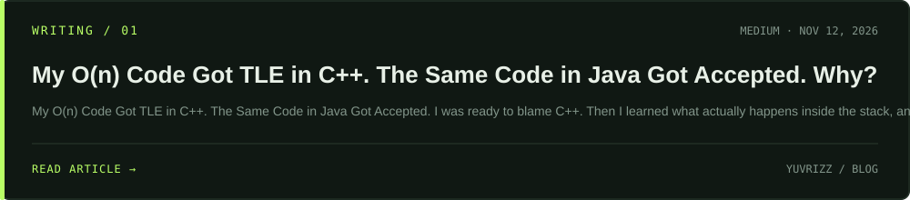

<!-- 
## About
-->

  

<!-- 
I'm passionate about problem-solving, Data Structures and Algorithms, and building things that help me learn through practice. I'm constantly exploring new technologies, improving my coding skills, and working towards becoming a better software engineer.
-->

## Tech Stack

&nbsp;&nbsp;

&nbsp;&nbsp;

&nbsp;&nbsp;

&nbsp;&nbsp;

&nbsp;&nbsp;

&nbsp;&nbsp;

&nbsp;&nbsp;

&nbsp;&nbsp;

&nbsp;&nbsp;

&nbsp;&nbsp;

&nbsp;&nbsp;

&nbsp;&nbsp;

&nbsp;&nbsp;

<!-- 

&nbsp;&nbsp;

---
-->

## Recent Writings 

  

    <i>"Thoughts, learnings &amp; things worth sharing."</i>
  

  

   

  

<!-- 

  

 -->

<!-- 

-->
